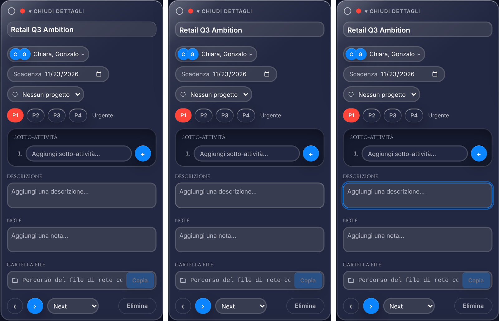

# UX audit — TEAM GTD FINALE

Usability, interaction and visual design audit of the web app (`web/`), with
the fixes applied in the same pass. Every finding below was reproduced in the
running app, traced to its source, fixed (or explained), and re-checked in all
four skin/appearance combinations — **Classic**, **Glass dark**, **Glass
light**, **Glass with blur off** — on desktop (1440×900, 1024×768) and phone
(390×844, 844×390).

Branch: `claude/hopeful-noether-u6oblf`. Base: `3a4f672`.

---

## How this was checked

The app needs Supabase and there is no offline mode, so the audit drives the
real app against an **in-memory fake Supabase** (no production data touched):

| Script (`web/scripts/ux/`) | What it does |
| --- | --- |
| `stub.mjs` | Answers auth, PostgREST reads/writes, the `is_team_member` RPC and the realtime socket for a fake host; seeds a small board (tasks in every column, two projects, weekly items). `openApp()` opens any route in any skin. |
| `shoot.mjs` | Screenshot a route in every combo. |
| `hoverdiff.mjs` | Hovers every field and reports which computed styles change — on the field, its `::after`, and five ancestors. |
| `tabs.mjs` + `sheet.py` | Rest / hover / keyboard-focus contact sheets for every tab-like control. |
| `axe.mjs` | axe-core (WCAG 2.0–2.2 A/AA) over the 9 desktop tabs and 6 phone screens in every combo. |
| `glasscontrast.mjs` | Glass text contrast against the skin's own opaque stand-ins (axe cannot compose translucent glass). |
| `targets.mjs` | Phone controls smaller than 44×44 px. |
| `nofield.mjs`, `weeklyundo.mjs`, `probe.mjs` | Spot checks used along the way. |

Run them with the dev server pointed at the fake host:

```bash
cd web && VITE_SUPABASE_URL=http://stub.supabase.local VITE_SUPABASE_ANON_KEY=stub VITE_TEAM_EMAIL=team@example.com npx vite --port 5199
```

```bash
cd web && node scripts/ux/axe.mjs desktop
```

`axe.mjs` needs axe-core, which is not a project dependency:
`npm i axe-core@4.10.2` anywhere and set `AXE_PATH` to its `axe.min.js`.

**Result, before → after:** axe found ~200 failing text nodes on the desktop
in Classic, white-on-blue failures on every Glass tab, and contrast plus 22
nested-control nodes on the phone. After: **0 axe violations** on all nine
desktop tabs and all six phone screens in all four combos, and 0 failures in
the Glass contrast estimate.

`npm run typecheck` and `npm test` (390 tests) pass after every commit.
(Typecheck needs `netlify/lib/fonts.generated.mjs`, which `npm run build`
generates; on a fresh checkout run `node scripts/gen-pdf-fonts.mjs` first.
That is pre-existing, not something this pass changed.)

---

## Findings

Screenshot paths `shots/…` are in `ux-audit/shots/`.
Severity: **blocker** (stops a task) · **major** (hurts a common task or a
group of users) · **minor** (noticeable, has a workaround) · **polish**.

| ID | Area | Skin | Sev. | What was wrong | Evidence | Fix | Status |
| --- | --- | --- | --- | --- | --- | --- | --- |
| F-01 | Board · task editor | Classic | major | **Known bug 1.** Hovering any field in an open task lit the whole card gold: the card kept its "open me" hover border while it held the editor. | `TaskCard.tsx:104`; `shots/bug1-compare-classic.png` (left) | Hover border only while the card is closed. | Fixed `c60cfd9` |
| F-02 | Board · subtasks | all | major | Subtask text got a fill on hover (`hover:bg-[#F5F3EF]`), i.e. a field highlighting under the mouse. | `SortableSubtasks.tsx:339` | Shared `.field` states (border step only). | Fixed `c60cfd9` |
| F-03 | New-task bar, editor pills | Glass | major | Field-shaped buttons (assignee picker, date and project pills) took the generic button hover rim (§7 outline, §11 `::after`), so they lit up unlike the inputs beside them. | `glass.css` §7, §11, `.qa-field`; `shots/bug1-before-qa-hover-*.png` | `.field` buttons excluded from the button hover rim; they share the field states. | Fixed `c60cfd9` |
| F-04 | All fields | all | major | ~35 one-off focus styles (`focus:border-gold`, `focus:ring-1`, `focus-within:`, a blue `#007AFF` ring in Report and Mail) and a Glass `:focus` rule that also fired on mouse clicks into selects; no shared disabled / read-only / invalid states (the login fields drew their own red). | `index.css`, `glass.css` §6 | One `.field` definition with `--field-*` tokens, both skins (see Tokens). | Fixed `c60cfd9`, `097da68` |
| F-05 | Main tabs | Classic | major | **Known bug 2.** Keyboard focus on a tab was the browser's black ring. | `shots/bug2-before-nav-sheet.png` (right column) | Shared `.tab` focus ring (gold). | Fixed `a2200bf` |
| F-06 | Main tabs | Glass light | major | Hover on an inactive tab was a white rim on white glass — invisible. | `bug2-before-nav-sheet.png` row 3 | `--ctl-hover-border` per appearance (darker rim on light). | Fixed `a2200bf` |
| F-07 | Every chosen-state control | all | major | Six different "selected" looks: navy/gold thumb, blue thumb, white thumb (appearance), gold/orange thumb (language), gold "on" for *Edit layout* beside navy *Team*/*Columns*, white chip (Music). | `bug2-before-*-sheet.png` | One `.tab` / `.seg` style in `styles/controls.css`; chosen = navy + gold (Classic), blue + white (Glass); state read from ARIA. | Fixed `a2200bf` |
| F-08 | Board · Names toggle | all | major | `aria-pressed` said "pressed" when names were **shown**, while the button was drawn "on" when they were **hidden**. | `BoardView.tsx` (Names) | `aria-pressed` = names hidden; label reads *Nomi nascosti / Names hidden* while on. | Fixed `a2200bf` |
| F-09 | Phone · segmented controls | all | minor | The phone used a neutral white thumb for segments but the accent for pills, and Classic's on-accent was cream (desktop: gold). | `mobile.css` `.m-seg` | Chosen segment = accent fill; Classic on-accent gold. | Fixed `a2200bf` |
| F-10 | Calendar · *Oggi* | all | minor | An action button exposed as a toggle (`aria-pressed`) and stayed clickable when it would do nothing. | `CalendarView.tsx:342` | Plain button, disabled while this month is shown. | Fixed `a2200bf` |
| F-11 | All tabs | Classic | major | Secondary grey `#8A8A8A` (2.9–3.45:1) and tertiary `#A8A29E` (2.1–2.5:1) as 10–12 px text — the most common text colours in the app. | axe; `shots/t0-board-classic.png` | `#8A8A8A` → `#6B6B6B`; `#A8A29E` → `text-ink-3` token (`#6E6A64` Classic, `--label-3` Glass). Glass unchanged. | Fixed `8c816f9` |
| F-12 | Project chips, health badges, overdue counts | all | major | Raw system colour as small text on its own 12 % tint: orange 1.7:1, red 3.0–3.5:1, white on the solid green pill 2.2:1. | `ProjectBits.tsx:72`, `TaskCard.tsx:196` | `.tint` / `.tint-text` / `.tint-solid`: the colour pulled toward the label ink; ≥4.5:1 for every project colour on every surface. | Fixed `0741c39` |
| F-13 | Chosen tabs, primary buttons | Glass | major | White 11–13 px text on `#0A84FF` (3.6:1) / `#007AFF` (4.0:1). | axe | `--accent-fill: #0071E3` (4.7:1) for blue fills behind text; `--ios-blue` stays for rings and links. | Fixed `8c816f9`, `8075b0d` |
| F-14 | Red text, gold-dark text, Settings/Reflection headings | Classic | minor | `#DC2626` on its tint 4.41:1; `#8B6F3E` on cream 4.26:1; gold `#C9A96E` headings on white 2.2:1. | axe | `#C81E1E`, `#7A5F30`. | Fixed `8c816f9` |
| F-15 | Gold / red / green small text | Glass | major | Light: gold labels → systemOrange 2.2:1, red 3.0:1, green 3.7:1. Dark: red 4.2:1. axe can't see these through glass. | `glasscontrast.mjs`; `shots/tour-settings-glass-light.png` (before) | Light: `#8A5A00`, `#D70015`, `#1A6B2E`; dark red text `#FF6961`. | Fixed `a86c13a` |
| F-16 | Phone · task cards | all | major | The card was `role="button"` containing the done checkbox — a control inside a control (axe *nested-interactive*, 22 nodes); screen readers can skip or merge the inner one. | `mobile/TaskCard.tsx:123` | The title is the card's real "open" button; tap-anywhere and swipes unchanged. | Fixed `8075b0d` |
| F-17 | Phone · text | Classic, Glass light | minor | Tertiary text 3.5:1 (Classic) / 3.8:1 (light glass); greeting name gold on cream 2:1. | axe | `--m-text-3` `#636977` / `--label-3`; greeting uses `--m-gold`. | Fixed `8075b0d` |
| F-18 | Phone · landscape | all | major | At 844×390 the header and floating bar took ~250 of 390 px; ~70 px of cards were visible, partly behind the bar. | `shots/phone-land-board-glass-dark.png` | Short-landscape mode: slimmer header, 48 px icon-only bar (labels still announced). | Fixed `0c26ce1`; after: `phone-land-board-after-*.png` |
| F-19 | Phone · touch targets | all | minor | Pills and segments 40 px tall (*Cerca* 39 px wide); desktop screens under *Altro* kept 32–40 px controls. | `targets.mjs` | 44 px minimum. | Fixed `0c26ce1` |
| F-20 | Keyboard focus | Classic | major | Most buttons fell back to the browser's black ring; Report and Mail forced a blue one. | — | Zero-specificity `:focus-visible` default in the accent colour. | Fixed `599186d`, `097da68` |
| F-21 | Undo | desktop | minor | Weekly drew its own undo bar (white pill, other place on screen) while every other delete used the shared toast. | `WeeklyView.tsx:479` | Weekly uses `showUndo`; the shared toast gains pause-on-hover/focus and focus-to-Annulla after keyboard deletes. | Fixed `0e05a8f`; `shots/weekly-undo-after.png` |
| F-22 | Weekly · column labels | all | minor | *Learnings* was a solid navy/gold (Glass: solid blue) pill — the selected-tab look — among four tinted labels. | `tour-weekly-*.png` | Blue information tint like its neighbours. | Fixed `0ec4a54`; `weekly-labels-after-sheet.png` |
| F-23 | Board · density | all | minor | The collapsed priority distribution was still a full ~75 px panel above the columns; the hint line read like developer notes. | `board-full-glass-light.png` | One compact 40 px row when collapsed; shorter hint. | Fixed `000903d`; `board-density-after-classic.png` |
| F-24 | Board · 1024 px | all | minor | Card titles broke mid-word in ~150 px columns (*Allineame/nto*). | `tour1024-board-glass-dark.png` | `hyphens: auto` for words ≥10 letters. | Fixed `df774c8`; `hyphen-1024-*.png` |
| F-25 | Project tasks · unlink | touch | minor | Unlink × hidden until hover from `sm:` up — unreachable on a touch tablet. | `ProjectTasks.tsx:499,630` | Shown on `hover:none` and when the row has focus. | Fixed `5409186` |
| F-26 | Connection badge | all | minor | Not a live region (going offline was silent to screen readers); dot pulsed forever once *Live*, ignoring reduced motion. | `ConnBadge.tsx` | `role="status"`; pulse only while connecting, `motion-safe`. | Fixed `5522909` |
| F-27 | Motion | Classic desktop | minor | No global `prefers-reduced-motion` handling outside Glass/phone/Music. | — | One global rule in `index.css`. | Fixed `c180c74` |
| F-28 | Menu mensa bar | all | minor | No `aria-expanded`; the ▶ glyph was read out. | `MenuBar.tsx:35` | `aria-expanded`, `aria-controls`, glyph hidden. | Fixed `e223bdf` |
| F-29 | Calendar filters | all | minor | Owner and priority selects had no accessible name (axe *select-name*, critical). | `Filters.tsx:39,50` | `aria-label`s. | Fixed `8c816f9` |
| F-30 | Images | all | polish | Header logo announced as "logo" next to the board-name heading; Settings previews had English `alt`. | `TopBar.tsx:64` | Decorative `alt=""`; translated labels. | Fixed `f23c335` |
| F-31 | Small type | all | minor | Reading text at 9–9.5 px (Reflection labels, Products tags, canteen courses/allergens). | `text-[9px]` | 10 px floor. | Fixed `26c97b3` |
| F-32 | Language switch | all | polish | The IT/EN group had no accessible name. | `LangToggle.tsx` | `role="group"` + label. | Fixed `a2200bf` |
| F-38 | Board · task card title | Glass | major | Hovering a closed card drew a white rounded box around its **title** only (the generic button hover rim on the card's title button), so the title looked like a text field lighting up. Present before this pass too (reported after it). | `TaskCard.tsx:131`, `glass.css` §7; `shots/cardhover-before-after.png` (left) | The title button skips the button rim; the whole card shows the hover, on its own `::after` fade (never repaints the blur), not while the card is open. | Fixed (see git log: "Glass task cards") |
| F-39 | Header | Glass | major | Hovering or opening a board card flashed a bright bar along the header's bottom edge: Chrome re-drew the sticky header's live blur in tiles on real GPUs (reported with a screenshot; not reproducible in a software compositor). | `glass.css` §4 | The header paints the wallpaper itself (fixed to the viewport, same film and saturation) instead of live-blurring the page: same look at rest, nothing to re-sample. | Fixed (git log: "Glass header: no live blur") — confirm on a real GPU |
| R-01 | Whole app | all | request | Team request: a control to turn colour up or down across the whole GTD. | — | *Intensità colori* 0–150 % (◐ in the header, Altro → Aspetto on a phone), one `saturate()` on `<html>`, per device, not printed. | Added (git log: "Colour intensity") |
| F-33 | Music tab | Glass light | minor | The Music tab is dark in both appearances, so its chips and pills (`#fff` in `musicTab.css`) never follow light mode. | `musicTab.css:440` ("dark in both appearances") | — | **Not fixed** — design decision, see below |
| F-34 | Music · play button | all | polish | Play button scales on hover (`transform: scale(1.06)`). Not on a blurred surface, so no seams, but it is the only hover that moves. | `musicTab.css:205` | — | Not fixed — inside Music's own design; harmless |
| F-35 | Type scale | all | polish | 14 arbitrary sizes (`text-[10px]` ×80, `[11px]` ×153, `[12px]` ×155, `[13px]` ×48, …). | grep | Scale defined below; not mass-migrated (see below). | Partly (F-31) |
| F-36 | Project detail · Notes | all | polish | The Notes box uses the warm warning tint, so it reads like an alert. | `tour-projects-p1-glass-light` | — | Not fixed — needs a call on what "notes" should look like |
| F-37 | Project chip at 1024 | all | polish | In narrow columns the project chip truncates to 2 letters when a *Passo n/N* follows. | `hyphen-1024-glass-dark.png` | — | Not fixed — needs a decision on what to drop first |

---

## The two known bugs, before and after

**1 · Text boxes highlight on hover** — `shots/bug1-compare-<combo>.png`, each
showing *before (hover)* · *after (hover)* · *after (focus)*:

| Classic | Glass dark | Glass light | Glass, blur off |
| --- | --- | --- | --- |
|  |  |  |  |

Measured with `hoverdiff.mjs`: before, the open editor's card border changed
(Classic) and the assignee button's `::after` rim / outline changed (Glass).
After, every field in every combo changes **only** its border colour, by one
step (e.g. `#E8E6E1 → #D6D0C4`, `rgba(255,255,255,.18 → .26)`), and nothing
around it changes.

**2 · Weird colours in the tabs** — contact sheets (rows: Classic, Glass dark,
Glass light, blur off; columns: rest, hover, keyboard focus):

- Main tabs: `bug2-before-nav-sheet.png` → `bug2-after-nav-sheet.png`
- Board/List: `bug2-before-boardview-sheet.png` → `bug2-after-boardview-sheet.png`
- Header switches (language, appearance): `bug2-before-projfilter-sheet.png` (the probe landed on the header) → `bug2-after-header-sheet.png`
- Board toolbar toggles: `bug2-after-toolbar-sheet.png`
- Report switch: `bug2-before-reportview-sheet.png` → `bug2-after-reportview-sheet.png`
- Projects, desktop and phone: `bug2-after-projects-*.png`, `bug2-after-phone-projects-*.png`

What was off, per control (before):

| Control | Classic | Glass dark | Glass light |
| --- | --- | --- | --- |
| Main tabs | chosen navy/gold ✓, **focus = black UA ring** | chosen blue, hover faint | chosen blue, **hover invisible** |
| Board/List, Cards/Timeline, project List/Board | navy/gold thumb, no focus style of its own | blue thumb | blue thumb |
| Report switch | navy/gold, **blue focus ring** | blue thumb + white-rim hover | same |
| Header language | **gold thumb** | **orange thumb** (`--on-warm` text) | orange thumb |
| Header appearance | — | **white thumb, dark icon** | **white thumb** (own `!important` overrides) |
| Board toolbar | Team/Columns navy, **Edit layout gold**, Names gold when *off* | blue / **orange** | blue / orange |
| Weekly grouping | navy/gold, **green hover text** | blue | blue |
| Phone segments | **white thumb**, pills navy + **cream** | white film thumb, pills blue | white thumb, pills blue |

After: one look for "chosen" everywhere (see *Tab / segmented-control states*).

---

## Tokens and scales

All new tokens are CSS variables defined for Classic in `index.css` /
`styles/controls.css` and re-pointed for **both** Glass appearances in
`styles/glass.css` (section 0 / 0b), so components never branch on the skin.

### Colour — text

| Step | Classic | Glass dark | Glass light | Min. contrast |
| --- | --- | --- | --- | --- |
| Label | `#0A1931` | `--label` `#FFFFFF` | `--label` `#11131A` | ≥ 12:1 |
| Secondary | `#6B6B6B` (`text-[#6B6B6B]`) | `--label-2` | `--label-2` | ≥ 4.5:1 on every surface |
| Tertiary | `--ink-3` `#6E6A64` (`text-ink-3`) | `--label-3` | `--label-3` | ≥ 4.56:1 |
| Gold text | `#7A5F30` | systemOrange | `#8A5A00` | ≥ 5:1 |
| Red text | `#C81E1E` | `#FF6961` | `#D70015` | ≥ 4.5:1 |
| Green text | `#065F46` | systemGreen | `#1A6B2E` | ≥ 4.5:1 |
| Phone tertiary | `--m-text-3` `#636977` | `--label-3` | `--label-3` | ≥ 4.6:1 |

Gold `#C9A96E` stays the brand **fill / accent** (chosen tab text on navy, the
header title, borders, dots) — it is not a text colour on light surfaces.

### Colour — accent and fills

| Token | Classic | Glass (both) | Use |
| --- | --- | --- | --- |
| `--ctl-on-bg` / `--ctl-on-fg` | navy `#0A1931` / gold `#C9A96E` | `--accent-fill` `#0071E3` / white | anything chosen |
| `--accent-fill` | — (navy) | `#0071E3` | blue fills behind white text |
| `--ios-blue` | — | `#0A84FF` / `#007AFF` | rings, borders, links, dots |
| `--tint` + `.tint` | text = colour 42 % + navy; fill = colour 12 % | dark: colour 55 % + white | chips and badges in a user/status colour |

### Type

Inter body, Cinzel display. The scale the app actually uses, with the floor
applied in this pass:

| Step | Size | Use |
| --- | --- | --- |
| Caption | 10 px | chips, meta, section eyebrows (Cinzel, tracked) — **floor** |
| Small | 11 px | secondary lines, counts |
| Body S | 12 px | controls, card meta, most UI text |
| Body | 13 px | inputs, card titles |
| Title S | 15–16 px | panel titles |
| Title | 20–22 px | board name, page titles |

Recommendation (not done, see below): name these in `tailwind.config.js`
(`text-caption`, `text-small`, …) and migrate the ~450 arbitrary
`text-[Npx]` uses in one mechanical commit.

### Radius

`rounded-full` for every control (pill/capsule); `rounded-[12px]` cards;
`rounded-[14px]` panels; `rounded-lg` (8 px) inline wells. Glass enlarges
panels (12 → 18 px, 14–18 → 22 px) — unchanged.

### Spacing and targets

Desktop controls 28–44 px tall (`h-7`, `h-8`, `h-9`, `h-11`), gaps 8 px
(`gap-2`). Phone: **44 px minimum** for every control (pills, segments, and
desktop screens shown under *Altro*).

### Field states (`.field`, `index.css`)

| State | Classic | Glass |
| --- | --- | --- |
| Rest | the component's border (`#E8E6E1`) | `--separator` / `--rim` |
| Hover | border `#D6D0C4` — one step, nothing else | `rgba(255,255,255,.26)` dark / `rgba(60,60,67,.30)` light |
| Focus (`:focus-visible`, or a wrapper `:has(:focus-visible)`) | border gold + 2 px ring `rgba(201,169,110,.45)` | border systemBlue + 2 px ring, fill deepens to `--fill-2` |
| Disabled | 55 % opacity, `not-allowed`, no hover | same |
| Read-only | no hover, default cursor; focus still shows | same |
| Invalid (`aria-invalid="true"`) | red border, red ring on focus | `--ios-red` |

The ring is an `outline`, not a `box-shadow`, so it never fights the glass
skin's inset rims. `.field--chrome` (the header's identity pill) skips the
hover step. A field-shaped `<button>` (assignee picker) carries `.field` and
is excluded from the generic button hover rim.

### Tab / segmented-control states (`.tab`, `.seg`, `styles/controls.css`)

| State | Standalone `.tab` | In a track `.seg > .tab` |
| --- | --- | --- |
| Rest | surface + hairline (`#FFF`/`#E8E6E1`; Glass: thin glass capsule) | transparent, secondary label |
| Hover | gold border (Classic); a brighter rim on its own `::after` layer that only fades (Glass — never repaints the blur) | label darkens |
| Chosen (`aria-current="page"`, `aria-pressed`, `aria-selected`, `aria-expanded="true"`) | navy + gold (Classic) · `#0071E3` + white (Glass) | same |
| Focus (`:focus-visible`) | 2 px ring in `--ctl-focus`, offset 2 px | same |
| Disabled | 45 %, no hover | same |
| Count inside (`.tab__count`) | 14 % of the text colour; 22 % black on chosen | same |

`.seg--chrome` is the navy-header variant in Classic (chosen = gold with navy
text); Glass resets it to the normal track. The phone follows the same rule
(`.m-pill`, `.m-seg`: chosen = `--m-accent-fill` + `--m-on-accent`).

Used by: main tabs, Board/List, the board toolbar (Team, Edit layout, Names,
Columns), Ongoing/Completed, Cards/Timeline, project List/Board and *On the
BOARD* mode, Diary/Notes, Report switch, Weekly grouping, language and
appearance, people chips (task editor, new-task bar, project leads), Products
sections and tag filters, Calendar *Oggi*.

---

## Not fixed, and why

| Item | Why | Options for the team |
| --- | --- | --- |
| **F-33 Music tab in light mode** | `musicTab.css` is deliberately dark in both appearances (a media-app look; its comments say so). Making it follow light mode is a redesign of ~900 lines, not a fix. | (a) keep it dark everywhere (current); (b) give it `--mt-*` light tokens under `[data-appearance="light"]` — about a day, mostly covers and gradients. |
| **F-35 Type scale migration** | ~450 `text-[Npx]` uses; renaming them is mechanical but touches almost every file and makes review hard to read alongside real fixes. | One follow-up commit: named sizes in `tailwind.config.js`, sed the classes, eyeball every tab. |
| **F-36 Project notes styling** | Whether notes should look like a sticky note (warm, current) or a plain field is a product call. | Plain `.field` textarea like the other notes boxes, or keep warm but without the orange rim. |
| **F-37 Project chip truncation at 1024** | Needs a rule for what gives way: the project name or *Passo n/N*. | Hide *Passo* below a width; or put it on its own line. |
| **Board defaults** | *Menu mensa* is open by default and very tall below the board; *Team* is collapsed; the new-task bar is always open. Changing defaults changes daily behaviour for everyone. | Recommendation: collapse *Menu mensa* by default (its header already shows today's dish of the day). |
| **Glass blur performance** | Hover repaints were already isolated (§10, §11); no new blurred hover was added (tab hover rims use the same `::after` fade). Real-device GPU jank can't be measured headless. | Check on the team's actual laptops with blur on; the *Sfocatura* switch remains the escape hatch. |
| **Phone keyboard behaviour** | The bar steps aside while typing (`data-typing`) and sheets use `--m-vvh`; a headless browser has no on-screen keyboard. | Check by hand (below). |
| **Report PDF** | Out of scope by instruction (`GlassReport`, `glassReport.css`, `.report-print-root`). The on-screen hover ring on editable report text (`.gr-ed:hover`, 3 px at 12 %) is subtle and left alone. | — |

---

## What to check by hand

1. **Real phone keyboard** (iOS Safari + Android Chrome): add a task from the
   **+**, edit a task title in its sheet — the bar must step aside and the
   sheet stay above the keyboard.
2. **Landscape phone**: the bar is now icon-only below 500 px tall; confirm
   the icons alone are clear enough for the team.
3. **Glass with blur on, real GPU**: hover across the tab bar and the board
   toolbar — no seams (the tab hover is an `::after` fade, like §11).
4. **Hyphenation**: Chrome on Windows/Linux and Safari hyphenate Italian;
   Firefox needs the `lang` attribute (set by `AuthGate`). Check a long title
   at 1024 px.
5. **Screen reader** (VoiceOver): on the phone, a task card now reads as a
   button (the title) plus a checkbox; on desktop, *Nomi* reads "pressed"
   when names are hidden; the connection badge announces offline.
6. **Weekly undo**: delete an item with the keyboard (focus moves to
   *Annulla*), then with the mouse (it doesn't).

## Questions for the team

1. Should the Music tab follow light mode (F-33)?
2. Collapse *Menu mensa* by default?
3. In Classic, chosen pills are navy with **gold** text everywhere now,
   including the phone (it was cream there). Happy with gold on the phone?
4. Is the warm "sticky note" look for project notes intentional (F-36)?
