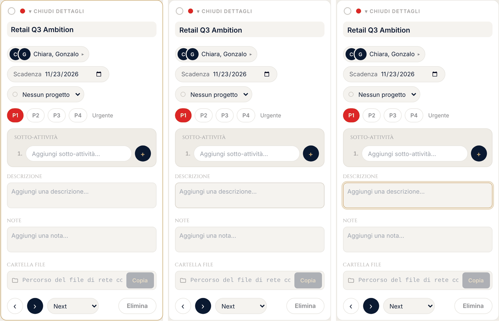
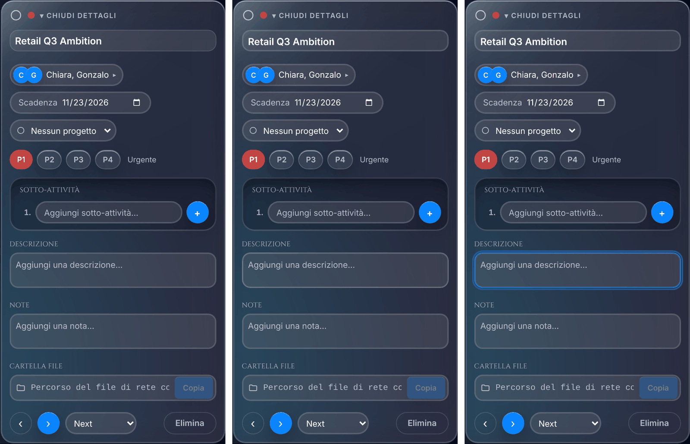
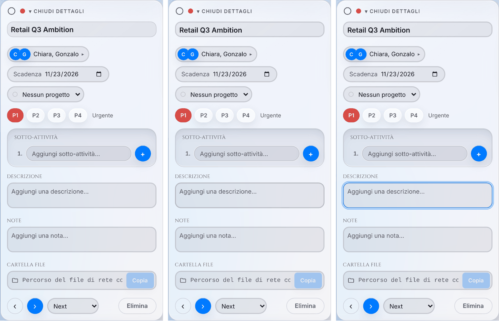

# UX audit — TEAM GTD FINALE

Usability, interaction and visual design audits of the web app (`web/`),
each with its fixes applied in the same pass. Two passes so far, newest
first:

- **2026-11-25, second pass** — a calm interface (one hover rule for the
  whole app, measured), then function, UX, UI, accessibility and
  performance. Branch `ux-audit-calm-hover`.
- **First pass** — field and tab states, contrast, phone ergonomics
  (findings F-01 … F-39). Branch `claude/hopeful-noether-u6oblf`.

The audit scripts are in `web/scripts/ux/`. The first pass's screenshots were
removed from the tree after the move to `Gualbertol123/GTD`
(`git checkout 48fc426 -- ux-audit` brings them back); this pass's are in
`ux-audit/shots/`.

---

## 2026-11-25 — Second pass: a calm interface, then function, UX and UI

Branch `ux-audit-calm-hover` of `Gualbertol123/GTD`, from `main` at
`99a7961` (Netlify deploys `main`; nothing here is on it until it is merged).
The audit scripts are back in `web/scripts/ux/`; screenshots of this pass are
in `ux-audit/shots/` (`hover-<before|after>-<case>-<combo>.jpg`, rest above
hover; `board-<before|after>-<1440|1024>-<combo>.jpg`; taken at
deviceScaleFactor 2, saved as JPEG to keep the repository small).

The pass started from one complaint: **the interface is restless.** Moving the
mouse across a page lit fields, drew rims and boxes, swapped colours and made
buttons appear. The first audit fixed that element by element (F-01, F-03,
F-38, F-39); this one treats it as a system problem with one rule.

### 1. The interaction rule, and what the pointer sweep measured

The rule is written in [`docs/interaction-rules.md`](docs/interaction-rules.md)
(and summarised in README §10). In one line: **a resting pointer changes
nothing but the cursor.** Fields have no hover state; buttons, tabs, cards,
rows and section headers have none either (the rule allows "a small tint or
nothing"; this app takes *nothing*, everywhere, which is also the only choice
that never repaints a blurred Glass surface); nothing appears or disappears
under the pointer; keyboard focus is always a clearly visible ring; only
something the user did on purpose animates. Two documented exceptions: the
item under the pointer inside an **open** menu or suggestion list keeps a
tint (it shows what a click will choose, like the keyboard's active item),
and the Undo toast pauses its countdown while the pointer is on it (WCAG
2.2.1; nothing on screen changes).

It is enforced centrally, twice:

- `src/lib/__tests__/hover-rule.test.ts` fails `npm test` (and CI) on any
  Tailwind `hover:` / `group-hover:` / `peer-hover:` class or `:hover` CSS
  selector outside the allowlist in that file.
- `web/scripts/ux/hoverdiff.mjs`, the **pointer sweep**: for every desktop
  tab (plus the board with a card open and in list view) and every phone
  screen, in Classic, Glass dark, Glass light and Glass with blur off, at
  1440×900 and 1024×768 (phone 390×844), it hit-tests a 24 px grid, moves
  the real mouse to one point per element hit, diffs the computed colour,
  background, border, outline, box-shadow, opacity, transform, visibility,
  display, filter and text decoration of **every** element and its
  `::before` / `::after` against rest, and watches the DOM. It scrolls down
  up to three screens. Each change is classified against the rule; anything
  not allowed is a violation and the script exits 1.

```bash
cd web && node scripts/ux/hoverdiff.mjs --label=after          # desktop, all combos and sizes
cd web && node scripts/ux/hoverdiff.mjs --mode=phone --label=after
cd web && node scripts/ux/sweepsummary.mjs before after --fix=beforefix   # the table below
```

**Elements that changed under the pointer / of which against the rule**,
summed over the four combos and both sizes (phone: four combos):

| Page | before: changed / violations | after: changed / violations |
| --- | --- | --- |
| board | 530 / 528 | 8 / 0 |
| board-card-open | 650 / 648 | 8 / 0 |
| board-list | 487 / 425 | 8 / 0 |
| projects | 318 / 318 | 8 / 0 |
| project-page | 422 / 422 | 8 / 0 |
| weekly | 296 / 296 | 8 / 0 |
| report | 232 / 232 | 8 / 0 |
| products | 374 / 361 | 8 / 0 |
| calendar | 318 / 311 | 8 / 0 |
| reflection | 218 / 218 | 8 / 0 |
| music | 374 / 372 | 0 / 0 |
| settings | 220 / 220 | 8 / 0 |
| m-today | 45 / 45 | 0 / 0 |
| m-board | 72 / 72 | 0 / 0 |
| m-projects | 33 / 33 | 0 / 0 |
| m-agenda | 99 / 99 | 0 / 0 |
| m-more | 54 / 54 | 0 / 0 |
| m-weekly | 27 / 27 | 0 / 0 |
| **total** | **4769 / 4681** | **88 / 0** |

Per combo, violations before → after: Classic 707 → 0, Glass dark 1326 → 0,
Glass light 1326 → 0, Glass blur off 1322 → 0. Before, by kind: 2,609 rims /
outlines / borders lighting up, 1,148 things appearing (an `::after` rim
fading in, a pencil, a ×, a ⋯, a play button), 544 field border steps, 276
text colour swaps, 56 changes on other elements, 24 slow tints. The 88
changes left are one element per page run: the harness blocks YouTube, so
the ♪ button's warm-up (pointer-enter preloads the player) shows an
"unreachable" toast — documented in `scripts/ux/hover-allow.json`, silent on
a normal network. The Music tab has no songs in the harness, so its rows and
cards are covered by the static guard, not the sweep.

The two cases the owner named, rest vs hover (`hover-before-*` →
`hover-after-*`): `newtask` (the "Nuova attività" field lit up in Glass),
`band` (a box drawn around "▼ ★ IN EVIDENZA 2"), plus `tabs`, `toolbar`,
`card`, `filters`, in all four combos.

The one root cause behind most of it: glass.css §7 gave every Glass
`<button>` `outline-color: var(--rim-top)` on hover — the box around the
band's title, around card titles, and on the phone a white ring left stuck
on a button after each tap (all 330 phone violations).

### How this pass was checked

Everything ran against the in-memory fake Supabase (`web/scripts/ux/stub.mjs`);
no production data was touched. Start the dev server as in the first pass
(below) and run from `web/`, with Playwright on `NODE_PATH` (and `AXE_PATH`
for axe):

| Script (`web/scripts/ux/`) | What it checks | Result now |
| --- | --- | --- |
| `hoverdiff.mjs` | The pointer sweep (§1) | 0 violations, all combos, both sizes, phone |
| `functional-board.mjs [section]` | Board, recurring, In evidenza, projects and board modes, phone, refused writes, races, before each migration (009, 013, 015, 016, 017, 023), realtime between two browsers | 182 pass, 1 fail (G-39, not fixed); was 171 / 12 |
| `functional-tabs.mjs [group,…]` | Weekly, Report, Calendar, Reflection, Products, Music, Settings, login, addresses / Back, IT/EN, offline | 88 pass, 0 fail; was 82 / 7 |
| `keyboard.mjs [desktop\|phone\|all] <combo> --sweep` | Keyboard-only flows, and the contrast of every focus indicator | no weak or invisible indicator, desktop and phone, all combos |
| `axe.mjs desktop\|phone` | axe-core WCAG 2.0–2.2 A/AA, 9 desktop tabs, 6 phone screens, all combos | 0 violations |
| `glasscontrast.mjs glass-dark\|glass-light` | Glass text contrast (axe cannot compose translucent glass) | 0 failures |
| `skindiff.mjs` | Classic vs Glass: every element's box, position, display, overflow, z-index, cursor | only the documented differences (G-40) |
| `fold.mjs` | Where the board's first column and card start | 568 / 625 px at 1440×900; 701 / 758 px at 1024×768 |
| `hovershots.mjs before\|after` | Rest vs hover images of the named cases | `ux-audit/shots/hover-*` |
| `sweepsummary.mjs` | The before / after table from the sweep JSON | §1 |

`stub.mjs` options added in this pass (defaults unchanged): `createStore()`
shares one fake database between browser contexts and broadcasts every write
as realtime `postgres_changes`; `reject` refuses chosen writes; `missing:
["023", …]` behaves as before that migration; `delayMs` / `jitterMs` let
writes land out of order. `npm run typecheck` and `npm test` (417 tests,
including the two new guards) pass on every commit.

### UI: tokens, skins, hierarchy

**Inventory** (components, excluding the report's own design): 72 distinct
hex colours (1,098 uses) — top `#6B6B6B` 191, `#0A1931` 177, `#E8E6E1` 153,
`#C9A96E` 125; 14 font sizes, mostly `[12px]` 162, `[11px]` 161, `[10px]`
88, `[13px]` 50; radii `full` 210, `[14px]` 46, `lg` 28, `[12px]` 19;
spacing almost all on Tailwind's 4 px grid. `tailwind.config.js` names navy,
gold, cream… and nothing uses them (only `ink-3`). Proposed scales: type
10 / 11 / 12 / 13 / 16 / 22; radius full / 14 / 12 / 8; eight neutrals plus
two inks; shadows popover / card / none. Only four near-duplicate colours
could merge with no visible change; the rest need an OK (§4, item 5), and
a rename must change glass.css in the same commit (G-09).

**Skins.** Apart from paint, Classic and Glass now differ only where
README §10 says so (G-40); the two Glass-only layout bugs found (G-04, G-05)
are fixed.

**Hierarchy.** Done: one loud button per area (G-07), no line on trays and
neutral chips (G-08), no eyebrow over every bar (G-06), a quiet status chip
on band cards. Proposed, not done (look changes): sentence-case field
labels instead of uppercase tracked ones in Settings; Weekly's column heads
as a coloured dot and a plain label instead of a bordered pill; Projects'
stat tiles without borders and dots; one status chip per project card.

### UX notes (measured; decisions in §4)

- **Consistency.** Priority is pills in the editor but a select in the
  new-task bar and filters; a person is multi-pick in the editor but a single
  select on a project's new task; deleting is an Undo toast (tasks, subtasks,
  members, weekly), an inline confirm plus Undo (weekly clear, projects), an
  inline confirm without Undo (notes, logo, logout) or `window.confirm()`
  (the report's Ripristina); there are five toast implementations.
- **Feedback before a migration.** Projects (015), multi-assign (009),
  recurring (023), notes and music each show a note; the In evidenza band
  (023) silently disappears; the report detects 013 only on write (G-34).
- **Phone.** Every control is at least 44 px except the card title buttons
  (inside a larger tappable card) and Weekly rows (42 px). The + and the tab
  bar are in thumb reach; the desktop screens under Altro put their primary
  actions at the top (Genera report at y=379; Settings' Save at 655 / 989 /
  1177, below the fold).
- **Copy left for a decision.** "Bacheca" (8 strings) vs "Board" (19);
  "Assegnatario" / "Assegnata a" / "Owner" for the same thing; «» vs “” in
  the two languages; four formats for "run migration NNN".

### 2. Findings

Severity as before: **blocker** · **major** · **minor** · **polish**. "Fixed"
means reproduced, fixed, and re-checked with the script named (in
`web/scripts/ux/`) or a unit test; commit subjects are in `git log`.

| ID | Area | Skin | Sev. | Finding | Cause in code | Fix | Status |
| --- | --- | --- | --- | --- | --- | --- | --- |
| G-01 | Whole app | all | major | **The restless interface**: 4,769 element changes under a resting pointer, 4,681 against the rule (§1). | glass.css §7 button rim and §11 `::after` hover layers; controls.css tab hovers; index.css field hover; 78 Tailwind `hover:` classes; ~40 `:hover` rules in the Music and report CSS | One rule, enforced by a test and by the sweep; hover styles deleted rather than overridden | Fixed — sweep 0 violations; `hover-rule.test.ts` |
| G-02 | Phone | Glass | major | Tapping any button left a white rim on it until the next tap elsewhere (sticky `:hover` on touch). | glass.css §7 | Same rule | Fixed — phone sweep 330 → 0 |
| G-03 | Board, Weekly, Projects, Music, Report | all | minor | Controls that existed only under the pointer: subtask delete, project unlink, weekly delete, the header's rename pencils (0.7 → 1), the report's ×, Music's ⋯, radio and play buttons, slider thumbs. Unreachable on touch laptops, invisible to anyone scanning the page. | `group-hover:opacity-100`; `:hover > .x { opacity: 1 }` | Always shown at a quiet weight (ink-3, 0.7–0.85); Music's row play icon is for keyboard focus only (a click on the row plays) | Fixed |
| G-04 | Header | Glass | major | Opening the colour-intensity pop-over pushed the header from 95 to 233 px and the page jumped (Glass only). | glass.css §3 forced `position: relative` on every panel and child at the skin's weight, beating Tailwind's `.absolute` | Positioning moved to zero-specificity `:where()` rules | Fixed — `skindiff.mjs`; header 95 → 95 px in all combos |
| G-05 | Header, Projects | Glass | major | The Vetro switch had no knob; project cards lost their colour stripe and the project page its hero bar (all 0 px). | as G-04 | as G-04 | Fixed — `skindiff.mjs` |
| G-06 | Board | all | major | At 1440×900 the first column started at y=763 (its first card below the fold); at 1024×768 no column was visible (y=911). | five stacked blocks; the band put each group on its own full-width row | Band groups side by side; the two eyebrows and the help line removed; band state remembered | Fixed — `fold.mjs`: 763 → 568 (1440), 911 → 701 (1024). At 1024 the first card is still at the fold: §4 |
| G-07 | Header | all | minor | "Aggiorna via mail", an occasional action, was the loudest fill on every page, competing with + Aggiungi and the chosen tab. | `TopBar.tsx` | Outlined like its neighbours | Fixed |
| G-08 | Board | all | polish | Boxes inside boxes: trays, meta chips and the band's status chip each drew a border. | `BoardView.tsx`, `MenuBar.tsx`, `TaskDetails.tsx`, `TaskCard.tsx` | Trays and neutral chips keep their fill and lose the line (transparent border: nothing moves) | Fixed |
| G-09 | Glass skin | Glass | polish | Three Glass rules styled classes no component uses; nothing would notice a renamed class losing its Glass look. | glass.css keys on Classic's literal class names | Dead rules removed; `glass-coupling.test.ts` fails when a restyled class is no longer used | Fixed |
| G-10 | Focus | all | major | Focus rings below 3:1 almost everywhere (1.4.11): Classic gold 2.0–2.2:1, field rings translucent (1.3–2.5:1), the Glass-dark header 1.65:1, Glass systemBlue 2.4–3.3:1 on its own panels; the phone's colour slider had none. With a calm hover, focus is the only state left, so it has to be clear. | `--ctl-focus`, `--field-ring`, seven hard-coded `ring-[#C9A96E]`, a `mobile.css` outline reset | One token: navy in Classic (gold on its navy header), white in Glass dark, Apple's high-contrast blue in Glass light; fields and the phone use it; the ring appears at once | Fixed — `keyboard.mjs --sweep`: no weak or invisible indicator, desktop and phone, all four combos |
| G-11 | Board editor | all | major | Enter (save) or Escape (revert) in a card's title dropped focus to `<body>`; the next Tab went to the skip link, ~30 stops away (2.4.3). | `TaskDetails.tsx` `blur()` | It commits, then focus returns to the field; a second Escape closes the card | Fixed |
| G-12 | Board editor | all | major | Moving a task with ‹ › or "Sposta in" re-mounted its card in another column and focus fell to `<body>`. | each column renders its own `TaskCard` | The moved card takes focus on its title (`lib/focusAfterMove.ts`) | Fixed |
| G-13 | Projects, toast | all | minor | Opening a project, and Undo / dismiss from the toast, left focus on `<body>`. | `ProjectsView.tsx`; the toast | The project page takes focus (named by the project); the toast gives focus back where it was, else to `#main` | Fixed |
| G-14 | Editor, project tasks | all | major | Names (4.1.2): the project select had an **empty** name (its label held only a colour dot); "+", "‹", "›" were named by their glyph; P1–P4 showed the chosen one by colour only; the project-task done toggle read "Done" / "Next" in both languages with no task, at 18 px. | `TaskDetails.tsx`, `ProjectTasks.tsx` | `aria-label`s; `aria-pressed`; the toggle is a checkbox named by its task, 24 px | Fixed |
| G-15 | Phone | all | minor | axe: the ★ chip was an `aria-label` on a role-less span (serious); amber and blue chip text 3.2–3.6:1; the In evidenza row acted as a switch without saying so. | `mobile/TaskCard.tsx`, `.m-chip`, `TaskSheet.tsx` | `role="img"`; chip text pulled toward the label ink like the desktop tints; `role="switch"` | Fixed — axe phone: 0 in all combos |
| G-16 | Board, Weekly, Calendar | all | major | **A refused write on the desktop was silent**: the change snapped back (or a "fatta · Annulla" toast stayed) and nothing said why. Phone Weekly too. | `useBoard.ts` stored the error where only the loading screen shows it; most callers pass no `onError` | Any refused write its screen does not report is shown in the shared toast: "Non salvato: … La bacheca mostra di nuovo ciò che è salvato" | Fixed — `functional-board.mjs refused` 11/11; `functional-tabs.mjs weekly` |
| G-17 | Offline | all | major | An edit made offline looked saved, then vanished on reconnect without a word; the badge read "Riconnessione…" throughout. | `useBoard.ts` | The toast says it was not saved, and why; the badge says Offline | Fixed (message, badge). Owner decision "opens offline, edits not kept": an offline edit is now refused up front (nothing changes on screen), not queued (§3) |
| G-18 | Recurring | all | major | A refused completion still inserted the next occurrence (two copies of the task); a refused next occurrence ended the series silently while the toast promised "prossima il …". | the writes of one send went out independently | The ops of one send are a group: nothing more is sent after a refusal, and a half-done completion is put back | Fixed — `optimisticSend.test.ts`; `functional-board.mjs refused` |
| G-19 | Projects, editor | all | major (intermittent) | Writes went out in parallel and could land out of order: Undo of a project delete lost its task links (2 runs in 4), Undo of a subtask delete put it last (2 in 5). | `createSend` fired every write at once | One write at a time, in the order sent | Fixed — `functional-board.mjs races` |
| G-20 | Recurring | all | major | "Every month on the 31st" became the 28th for good after February (and 29 Feb yearly the 28th). | each date was computed from the last occurrence's due date | The rule keeps its anchor day (`recurrence.anchor`, jsonb: no migration) | Fixed — `recurrence.test.ts` |
| G-21 | Projects (sequential) | all | major | Linking an existing, older task to a sequential project made it step 1 and took the step in progress off the BOARD. | `orderedProjectTasks` sorts unlisted tasks by age; linking wrote only `projectId` | Linking also writes the step order with the task last | Fixed — `functional-board.mjs projects` 32/32 |
| G-22 | Board (realtime) | all | minor | Two quick subtask ticks: the second un-ticked for ~200 ms while saving, and a click in that window really unticked it. | the echo of write 1 re-read the row without write 2 | Server rows are committed with the still-unconfirmed local ops on top | Fixed — `functional-board.mjs races` 3/3 |
| G-23 | Board editor | all | minor | Moving a task with ‹ › or "Sposta in" closed its editor, so stepping through columns meant reopening it each time. | each column renders its own `TaskCard`, `open` is local | The moved card reopens (with G-12) | Fixed — `functional-board.mjs board.editor` 5/5 |
| G-24 | Phone | all | major | Opening Ripeti / Priorità / Scadenza / Stato from a task sheet left focus on the row behind the picker; Escape then dropped it to `<body>` (2.4.3). | `mobile/ui.tsx` `Sheet`: a re-run effect (StrictMode) restored focus out of the new picker and recorded the picker as its own opener | Opener captured once at first render; the delayed restore runs only if the sheet really closed | Fixed — picker probe: Enter → in the picker, Escape → back on the row; `functional-board.mjs phone` 26/26 |
| G-25 | Phone | all | minor | Switching to the phone layout on `#/projects/<id>` dropped the project (README §1c promises the place is kept). | `mobileRoute` drops `sub`; the project sheet is not in the address | The phone opens that project's sheet | Fixed one way — `functional-tabs.mjs routes` 16/16. Phone → desktop still lands on the list |
| G-26 | In evidenza | all | polish | With filters hiding every highlighted task, the band said "drag a task here to highlight it". | `BoardView.tsx` | "Nessuna attività in evidenza corrisponde ai filtri." | Fixed |
| G-27 | Board | all | polish | `waiting_since` was the UTC date: a task moved to Waiting between 00:00 and 02:00 in Italy got yesterday. | `QuickAdd.tsx`, `localReducer.ts`, `db.ts`: `toISOString().slice(0,10)` | `toISODate` (local), like the rest of the app | Fixed |
| G-28 | Settings | all | minor | The inline "Sicuro? Sì / No" focused Sì: Enter at once logged out or removed the logo (every other confirm focuses No). | `SettingsView.tsx` `ConfirmInline` | Focus on No | Fixed |
| G-29 | Music | all | minor | Any failed call to the music server read "Sei offline" while online. | `music.ts` mapped every fetch exception to `offline` | "offline" only when the device is; else the generic server error | Fixed |
| G-30 | Copy | all | minor | Mixed and inconsistent wording: "Prossimi step", "Annullare" for the report's Ripristina (the Undo verb), "Acoustic" in Italian, "sotto-attività" / "sottoattività", the Done bar "questa settimana" for a rolling 7 days; 14 unused keys. | `i18n*.ts` | "Prossimi passi", "Scartare / Discard", "Acustica", "sottoattività", "negli ultimi 7 giorni"; dead keys removed; parity test passes | Fixed. Remaining terms in §3 / §4 |
| G-31 | Performance | Glass | minor | 825 compositing layers (~184 MB) on a 300-task board: every control inside glass had its own layer for hover repaints that no longer exist. | glass.css §11 `will-change` | Only fields being typed in keep one | Fixed — layers 825 → 45; frame times unchanged in a software compositor: check on a GPU (§4) |
| G-32 | Performance | all | minor | First load downloaded Report, Calendar, Settings, Products and the Music tab before the board could show. | static imports in `App.tsx`, `MoreScreen.tsx` | Loaded when first opened | Fixed — main JS 253.6 → 201.0 kB gzip (−21%), main CSS 26.4 → 17.8 kB gzip |
| G-33 | Performance | all | minor | One remote change (or the idle 30 s poll) re-renders every TaskCard: 321 of 321 at 300 tasks, 54–66 ms in a dev build. | TaskCard reads all tasks from context; every poll builds new task objects | — | Not fixed — §3 |
| G-34 | Report | all | minor | Before migration 013, × on a project shows "escluso da tutti i report · Annulla" **and** "Non salvato: esegui migration-013" (twice); the message blames 013 for any failure. | `ReportView.tsx` toast before the write; `report.excludeFailed` | — | Not fixed — show the toast after the write succeeds; name 013 only for PGRST204 / 42703 |
| G-35 | Report | all | minor | A past week's draft does not reopen: the tab always opens on this week. | `ReportView.tsx` starts at `weekPeriod(0)` | — | Not fixed — remember the last period |
| G-36 | Settings | all | polish | Login duration 0 / 500 / −3: the browser's own bubble, in the browser's language. | `SettingsView.tsx` `normDays` never runs | — | Not fixed — clamp on blur |
| G-37 | Reflection, notes | all | minor | Personal notes: inline confirm, no Undo; reflection entries cannot be deleted at all (`reflectionDelete` exists, unused); a refused reflection read looks like "no entries". | `PersonalNotes.tsx`, `db.ts` | — | Not fixed — needs the delete pattern decided (§4) |
| G-38 | PWA | all | minor | The "Nuova attività" shortcut works on the phone layout only; the first visit precaches nothing (offline after one visit opens a broken shell); the runtime cache is never trimmed. | `MobileApp.tsx`, `public/sw.js` | The shortcut focuses the Board's new-task field on the desktop; the first visit precaches the shell and every built file; activate drops older builds | Fixed after the owner's decision (README §1d; `scripts/ux/offline-pwa.mjs`) |
| G-39 | Phone | all | polish | Before migration 023 the phone task sheet hides Ripeti and In evidenza without saying what to run (the desktop editor says it). | `TaskSheet.tsx` | — | Not fixed |
| G-40 | Classic / Glass | — | polish | README §10 said the skins differ in paint only. Measured (`skindiff.mjs`): the header is sticky in Glass only, Aspetto and the blur button exist in Glass only, panels are positioned boxes; nothing else moves (after G-04 / G-05). | — | README §10 lists them | Documented |

### 3. Deliberately not changed, and why

| Item | Why | What it would take |
| --- | --- | --- |
| **Hover tints** on buttons and rows (allowed by the rule) | The rule permits "a small tint or nothing"; *nothing* is calmer, is the same everywhere, and is the only choice that never repaints a blurred Glass surface (the cause of F-39's flashing). The sweep still accepts a tint (`ok-tint`) if one is wanted later. | Add one `background-color` step on `:hover` for the chosen elements, ≤ 100 ms, and allow it in `hover-rule.test.ts`. |
| **Undo toast pausing under the pointer**; the ♪ button warming the player on pointer-enter | Neither changes anything on screen; the first is WCAG 2.2.1. | — |
| **Re-renders on every change** (perf) | Measured with 300 tasks (dev build): one remote change re-renders all 321 TaskCards (66 ms), the 30 s poll the same (54 ms). The cause is structural: every card reads all tasks from context to number sequential steps, and every poll builds new task objects. A real fix reworks the sync layer (keep unchanged objects, pass steps as props, memoise TaskCard). The team's board is far smaller than 300 tasks. | `React.memo(TaskCard)` with id-based callbacks, `useMemo` for the projects context, steps as a prop, and `reload()` reusing unchanged task objects: ~1 card per change, 0 per idle poll. |
| **Offline edits queued and sent later** | The owner decided "opens offline, edits not kept" (README §1d): the app opens offline and says so, and an edit made offline is refused up front with a message instead of being queued. | A persistent outbox replayed on `online`. |
| **Type-scale and colour-token migration** | The tokens inventory (in the agent notes below) found 72 hex values and 14 font sizes in components; Tailwind's named colours are defined and unused. The near-duplicates that could merge invisibly have four uses in all; the rest change the look. glass.css keys on the literal class names, so a rename must change both sides in one commit (the new `glass-coupling.test.ts` now catches a miss). | One mechanical commit per scale, after the owner OKs the visible merges (§4). |
| **Report's PDF / Word**, the server PDF | Unchanged; the screen-only × on report cards is now always visible (never exported). | — |
| **Delete flows that differ** (U3): Undo toast vs inline confirm vs `window.confirm()` | Unifying them changes how deleting works in five places; listed for the owner with the consistency findings. | One pattern: delete + Undo toast everywhere, no confirms. |
| **Five toast implementations** | Shared (desktop), Calendar, Report, Music, phone. Merging is a refactor; the save-error notice uses the shared one on both layouts. | Route the four others through `showUndo` / `showNotice`. |

### 4. What needs the owner

#### Decisions (features and information architecture: not changed without you)

1. **Tabs (U2).** Today: BOARD · PROGETTI · WEEKLY · REPORT · PRODOTTI ·
   CALENDARIO · RIFLESSIONE · MUSICA · IMPOSTAZIONI, plus a ♫ button and five
   display controls in the header. Three weekly outputs live in three places
   (WEEKLY, REPORT, the header's mail), settings are split between the header
   and IMPOSTAZIONI, MUSICA is both a tab and a header button, and PRODOTTI
   (reference material) sits among the workflow tabs. Proposal: **BOARD ·
   PROGETTI · CALENDARIO · SETTIMANA** (Weekly | Report | Mail) **·
   RIFLESSIONE · Altro ▾** (Prodotti, Musica, Impostazioni) — the phone's
   5 + Altro, mirrored.
2. **Header display controls.** Language, Vetro, Aspetto, blur and colour
   intensity are five pills; at 1024 px they wrap the header to two rows.
   One "Aspetto ▾" menu would give back ~50 px above the board.
3. **Board at 1024×768 (G-6).** The first card still sits at the fold.
   Options, cheapest first: collapse *In evidenza* by default below 1200 px;
   make the new-task bar a single field that expands on focus (~60–90 px);
   fold the priority distribution into the toolbar as chips.
4. **Menu mensa** is open by default and ~760 px tall under the columns
   (also asked in the first pass). Collapse by default? Its header already
   shows the dish of the day.
5. **Secondary vs tertiary text** in Classic (`#6B6B6B` vs `--ink-3`
   `#6E6A64`) are the same luminance, so Classic has no real tertiary step.
   Darken the secondary to about `#55524D`? It is a look change across
   ~190 places.
6. **"In evidenza" means two things**: the board's ★ band and the report
   cover's picked tasks. Rename the report's ("Da sottolineare"), or fill it
   from ★?
7. **"Questa settimana" (F11).** The board's Done bar is the last 7 days;
   Weekly is the calendar week. One definition, or the copy fix
   already made (the Done bar now says "negli ultimi 7 giorni").
8. **Spotify policy** (from §1e, still open).

#### Only on a real device or GPU

1. **Glass with blur on, real GPU**: move the mouse over the board, the
   tabs and the toolbar. With no hover repaints left there should be nothing
   to flash; also press buttons (the only Glass repaint left under the
   pointer is the 80 ms press dim).
2. **Focus rings** in the four combos on the team's screens: white in Glass
   dark, deep blue in Glass light, navy in Classic, gold on Classic's header.
3. **Phone**: tap buttons in Glass — no ring should stay behind; the
   on-screen keyboard with the + sheet and a task sheet (unchanged).
4. **Saving errors**: on the live site, a refused write is rare; the
   message can be seen by going offline (airplane mode) and ticking a task.
5. **Realtime**: the "re-apply pending edits" change was checked against
   the fake server's message shape (supabase-js 2.116); check two people
   ticking subtasks of the same task on the live site.
6. **Recurring on the 31st** after the next month-end on live data.

### The ten changes you will notice most

1. **Nothing lights up under the mouse any more.** Fields, tabs, buttons,
   cards and section headers stay as they are; the "box around IN EVIDENZA"
   and the glowing "Nuova attività" field are gone, and on the phone no ring
   stays on a button after a tap. Only the cursor changes.
2. **Buttons that only appeared on hover are always there**, quietly: the ×
   on subtasks, weekly items and project tasks, the ⋯ and play buttons in
   Music, the rename pencils, the report's ×.
3. **The board's columns start ~200 px higher**, and the In evidenza band
   takes one row: at 1440×900 the first cards are visible without scrolling.
4. **A save that fails now says so** ("Non salvato: …"), offline included,
   and the badge reads *Offline* instead of *Riconnessione…*.
5. **Keyboard focus is a clear ring** everywhere — navy in Classic, white on
   dark glass, deep blue on light glass — and it no longer jumps to the top
   of the page after saving a title, moving a task, opening a project or
   pressing Annulla.
6. **Recurring tasks behave**: "every month on the 31st" comes back to the
   31st, and a completion that fails to save never leaves two copies.
7. **Sequential projects keep their current step** when you link another
   task to them.
8. **Moving a task with ‹ › keeps its editor open**, so you can step it
   across the columns.
9. **A calmer header and board**: the mail button is outlined instead of
   gold, trays and grey chips lose their borders, and the bars above the
   columns lose their Cinzel captions.
10. **Faster and lighter**: the first load downloads 21% less JavaScript,
    Glass uses 45 compositing layers instead of 825 on a big board, and in
    Glass the colour pop-over no longer pushes the page down (the Vetro
    switch has its knob back, projects their colour bars).

---

## First pass

Every finding below was reproduced in the running app, traced to its source,
fixed (or explained), and re-checked in all four skin/appearance
combinations — **Classic**, **Glass dark**, **Glass light**, **Glass with
blur off** — on desktop (1440×900, 1024×768) and phone (390×844, 844×390).
Branch at the time: `claude/hopeful-noether-u6oblf` (repo `prova_sito_GTD`).
Base: `3a4f672`.

### How this was checked

The app needs Supabase and there is no offline mode, so the audit drives the
real app against an **in-memory fake Supabase** (no production data touched):

| Script (`web/scripts/ux/`) | What it does |
| --- | --- |
| `stub.mjs` | Answers auth, PostgREST reads/writes, the `is_team_member` RPC and the realtime socket for a fake host; seeds a small board (tasks in every column, two projects, weekly items). `openApp()` opens any route in any skin. |
| `shoot.mjs` | Screenshot a route in every combo. |
| `hoverdiff.mjs` | Hovers every field and reports which computed styles change — on the field, its `::after`, and five ancestors. |
| `tabs.mjs` + `sheet.py` | Rest / hover / keyboard-focus contact sheets for every tab-like control. |
| `axe.mjs` | axe-core (WCAG 2.0–2.2 A/AA) over the 9 desktop tabs and 6 phone screens in every combo. |
| `glasscontrast.mjs` | Glass text contrast against the skin's own opaque stand-ins (axe cannot compose translucent glass). |
| `targets.mjs` | Phone controls smaller than 44×44 px. |
| `nofield.mjs`, `weeklyundo.mjs`, `probe.mjs` | Spot checks used along the way. |

Run them with the dev server pointed at the fake host:

```bash
cd web && VITE_SUPABASE_URL=http://stub.supabase.local VITE_SUPABASE_ANON_KEY=stub VITE_TEAM_EMAIL=team@example.com npx vite --port 5199
```

```bash
cd web && node scripts/ux/axe.mjs desktop
```

`axe.mjs` needs axe-core, which is not a project dependency:
`npm i axe-core@4.10.2` anywhere and set `AXE_PATH` to its `axe.min.js`.

**Result, before → after:** axe found ~200 failing text nodes on the desktop
in Classic, white-on-blue failures on every Glass tab, and contrast plus 22
nested-control nodes on the phone. After: **0 axe violations** on all nine
desktop tabs and all six phone screens in all four combos, and 0 failures in
the Glass contrast estimate.

`npm run typecheck` and `npm test` (390 tests) pass after every commit.
(Typecheck needs `netlify/lib/fonts.generated.mjs`, which `npm run build`
generates; on a fresh checkout run `node scripts/gen-pdf-fonts.mjs` first.
That is pre-existing, not something this pass changed.)

---

### Findings

Screenshot paths `shots/…` are in `ux-audit/shots/`.
Severity: **blocker** (stops a task) · **major** (hurts a common task or a
group of users) · **minor** (noticeable, has a workaround) · **polish**.

| ID | Area | Skin | Sev. | What was wrong | Evidence | Fix | Status |
| --- | --- | --- | --- | --- | --- | --- | --- |
| F-01 | Board · task editor | Classic | major | **Known bug 1.** Hovering any field in an open task lit the whole card gold: the card kept its "open me" hover border while it held the editor. | `TaskCard.tsx:104`; `shots/bug1-compare-classic.png` (left) | Hover border only while the card is closed. | Fixed `c60cfd9` |
| F-02 | Board · subtasks | all | major | Subtask text got a fill on hover (`hover:bg-[#F5F3EF]`), i.e. a field highlighting under the mouse. | `SortableSubtasks.tsx:339` | Shared `.field` states (border step only). | Fixed `c60cfd9` |
| F-03 | New-task bar, editor pills | Glass | major | Field-shaped buttons (assignee picker, date and project pills) took the generic button hover rim (§7 outline, §11 `::after`), so they lit up unlike the inputs beside them. | `glass.css` §7, §11, `.qa-field`; `shots/bug1-before-qa-hover-*.png` | `.field` buttons excluded from the button hover rim; they share the field states. | Fixed `c60cfd9` |
| F-04 | All fields | all | major | ~35 one-off focus styles (`focus:border-gold`, `focus:ring-1`, `focus-within:`, a blue `#007AFF` ring in Report and Mail) and a Glass `:focus` rule that also fired on mouse clicks into selects; no shared disabled / read-only / invalid states (the login fields drew their own red). | `index.css`, `glass.css` §6 | One `.field` definition with `--field-*` tokens, both skins (see Tokens). | Fixed `c60cfd9`, `097da68` |
| F-05 | Main tabs | Classic | major | **Known bug 2.** Keyboard focus on a tab was the browser's black ring. | `shots/bug2-before-nav-sheet.png` (right column) | Shared `.tab` focus ring (gold). | Fixed `a2200bf` |
| F-06 | Main tabs | Glass light | major | Hover on an inactive tab was a white rim on white glass — invisible. | `bug2-before-nav-sheet.png` row 3 | `--ctl-hover-border` per appearance (darker rim on light). | Fixed `a2200bf` |
| F-07 | Every chosen-state control | all | major | Six different "selected" looks: navy/gold thumb, blue thumb, white thumb (appearance), gold/orange thumb (language), gold "on" for *Edit layout* beside navy *Team*/*Columns*, white chip (Music). | `bug2-before-*-sheet.png` | One `.tab` / `.seg` style in `styles/controls.css`; chosen = navy + gold (Classic), blue + white (Glass); state read from ARIA. | Fixed `a2200bf` |
| F-08 | Board · Names toggle | all | major | `aria-pressed` said "pressed" when names were **shown**, while the button was drawn "on" when they were **hidden**. | `BoardView.tsx` (Names) | `aria-pressed` = names hidden; label reads *Nomi nascosti / Names hidden* while on. | Fixed `a2200bf` |
| F-09 | Phone · segmented controls | all | minor | The phone used a neutral white thumb for segments but the accent for pills, and Classic's on-accent was cream (desktop: gold). | `mobile.css` `.m-seg` | Chosen segment = accent fill; Classic on-accent gold. | Fixed `a2200bf` |
| F-10 | Calendar · *Oggi* | all | minor | An action button exposed as a toggle (`aria-pressed`) and stayed clickable when it would do nothing. | `CalendarView.tsx:342` | Plain button, disabled while this month is shown. | Fixed `a2200bf` |
| F-11 | All tabs | Classic | major | Secondary grey `#8A8A8A` (2.9–3.45:1) and tertiary `#A8A29E` (2.1–2.5:1) as 10–12 px text — the most common text colours in the app. | axe; `shots/t0-board-classic.png` | `#8A8A8A` → `#6B6B6B`; `#A8A29E` → `text-ink-3` token (`#6E6A64` Classic, `--label-3` Glass). Glass unchanged. | Fixed `8c816f9` |
| F-12 | Project chips, health badges, overdue counts | all | major | Raw system colour as small text on its own 12 % tint: orange 1.7:1, red 3.0–3.5:1, white on the solid green pill 2.2:1. | `ProjectBits.tsx:72`, `TaskCard.tsx:196` | `.tint` / `.tint-text` / `.tint-solid`: the colour pulled toward the label ink; ≥4.5:1 for every project colour on every surface. | Fixed `0741c39` |
| F-13 | Chosen tabs, primary buttons | Glass | major | White 11–13 px text on `#0A84FF` (3.6:1) / `#007AFF` (4.0:1). | axe | `--accent-fill: #0071E3` (4.7:1) for blue fills behind text; `--ios-blue` stays for rings and links. | Fixed `8c816f9`, `8075b0d` |
| F-14 | Red text, gold-dark text, Settings/Reflection headings | Classic | minor | `#DC2626` on its tint 4.41:1; `#8B6F3E` on cream 4.26:1; gold `#C9A96E` headings on white 2.2:1. | axe | `#C81E1E`, `#7A5F30`. | Fixed `8c816f9` |
| F-15 | Gold / red / green small text | Glass | major | Light: gold labels → systemOrange 2.2:1, red 3.0:1, green 3.7:1. Dark: red 4.2:1. axe can't see these through glass. | `glasscontrast.mjs`; `shots/tour-settings-glass-light.png` (before) | Light: `#8A5A00`, `#D70015`, `#1A6B2E`; dark red text `#FF6961`. | Fixed `a86c13a` |
| F-16 | Phone · task cards | all | major | The card was `role="button"` containing the done checkbox — a control inside a control (axe *nested-interactive*, 22 nodes); screen readers can skip or merge the inner one. | `mobile/TaskCard.tsx:123` | The title is the card's real "open" button; tap-anywhere and swipes unchanged. | Fixed `8075b0d` |
| F-17 | Phone · text | Classic, Glass light | minor | Tertiary text 3.5:1 (Classic) / 3.8:1 (light glass); greeting name gold on cream 2:1. | axe | `--m-text-3` `#636977` / `--label-3`; greeting uses `--m-gold`. | Fixed `8075b0d` |
| F-18 | Phone · landscape | all | major | At 844×390 the header and floating bar took ~250 of 390 px; ~70 px of cards were visible, partly behind the bar. | `shots/phone-land-board-glass-dark.png` | Short-landscape mode: slimmer header, 48 px icon-only bar (labels still announced). | Fixed `0c26ce1`; after: `phone-land-board-after-*.png` |
| F-19 | Phone · touch targets | all | minor | Pills and segments 40 px tall (*Cerca* 39 px wide); desktop screens under *Altro* kept 32–40 px controls. | `targets.mjs` | 44 px minimum. | Fixed `0c26ce1` |
| F-20 | Keyboard focus | Classic | major | Most buttons fell back to the browser's black ring; Report and Mail forced a blue one. | — | Zero-specificity `:focus-visible` default in the accent colour. | Fixed `599186d`, `097da68` |
| F-21 | Undo | desktop | minor | Weekly drew its own undo bar (white pill, other place on screen) while every other delete used the shared toast. | `WeeklyView.tsx:479` | Weekly uses `showUndo`; the shared toast gains pause-on-hover/focus and focus-to-Annulla after keyboard deletes. | Fixed `0e05a8f`; `shots/weekly-undo-after.png` |
| F-22 | Weekly · column labels | all | minor | *Learnings* was a solid navy/gold (Glass: solid blue) pill — the selected-tab look — among four tinted labels. | `tour-weekly-*.png` | Blue information tint like its neighbours. | Fixed `0ec4a54`; `weekly-labels-after-sheet.png` |
| F-23 | Board · density | all | minor | The collapsed priority distribution was still a full ~75 px panel above the columns; the hint line read like developer notes. | `board-full-glass-light.png` | One compact 40 px row when collapsed; shorter hint. | Fixed `000903d`; `board-density-after-classic.png` |
| F-24 | Board · 1024 px | all | minor | Card titles broke mid-word in ~150 px columns (*Allineame/nto*). | `tour1024-board-glass-dark.png` | `hyphens: auto` for words ≥10 letters. | Fixed `df774c8`; `hyphen-1024-*.png` |
| F-25 | Project tasks · unlink | touch | minor | Unlink × hidden until hover from `sm:` up — unreachable on a touch tablet. | `ProjectTasks.tsx:499,630` | Shown on `hover:none` and when the row has focus. | Fixed `5409186` |
| F-26 | Connection badge | all | minor | Not a live region (going offline was silent to screen readers); dot pulsed forever once *Live*, ignoring reduced motion. | `ConnBadge.tsx` | `role="status"`; pulse only while connecting, `motion-safe`. | Fixed `5522909` |
| F-27 | Motion | Classic desktop | minor | No global `prefers-reduced-motion` handling outside Glass/phone/Music. | — | One global rule in `index.css`. | Fixed `c180c74` |
| F-28 | Menu mensa bar | all | minor | No `aria-expanded`; the ▶ glyph was read out. | `MenuBar.tsx:35` | `aria-expanded`, `aria-controls`, glyph hidden. | Fixed `e223bdf` |
| F-29 | Calendar filters | all | minor | Owner and priority selects had no accessible name (axe *select-name*, critical). | `Filters.tsx:39,50` | `aria-label`s. | Fixed `8c816f9` |
| F-30 | Images | all | polish | Header logo announced as "logo" next to the board-name heading; Settings previews had English `alt`. | `TopBar.tsx:64` | Decorative `alt=""`; translated labels. | Fixed `f23c335` |
| F-31 | Small type | all | minor | Reading text at 9–9.5 px (Reflection labels, Products tags, canteen courses/allergens). | `text-[9px]` | 10 px floor. | Fixed `26c97b3` |
| F-32 | Language switch | all | polish | The IT/EN group had no accessible name. | `LangToggle.tsx` | `role="group"` + label. | Fixed `a2200bf` |
| F-38 | Board · task card title | Glass | major | Hovering a closed card drew a white rounded box around its **title** only (the generic button hover rim on the card's title button), so the title looked like a text field lighting up. Present before this pass too (reported after it). | `TaskCard.tsx:131`, `glass.css` §7; `shots/cardhover-before-after.png` (left) | The title button skips the button rim; the whole card shows the hover, on its own `::after` fade (never repaints the blur), not while the card is open. | Fixed (see git log: "Glass task cards") |
| F-39 | Header | Glass | major | Hovering or opening a board card flashed a bright bar along the header's bottom edge: Chrome re-drew the sticky header's live blur in tiles on real GPUs (reported with a screenshot; not reproducible in a software compositor). | `glass.css` §4 | The header paints the wallpaper itself (fixed to the viewport, same film and saturation) instead of live-blurring the page: same look at rest, nothing to re-sample. | Fixed (git log: "Glass header: no live blur") — confirm on a real GPU |
| R-01 | Whole app | all | request | Team request: a control to turn colour up or down across the whole GTD. | — | *Intensità colori* 0–150 % (◐ in the header, Altro → Aspetto on a phone), one `saturate()` on `<html>`, per device, not printed. | Added (git log: "Colour intensity") |
| F-33 | Music tab | Glass light | minor | The Music tab is dark in both appearances, so its chips and pills (`#fff` in `musicTab.css`) never follow light mode. | `musicTab.css:440` ("dark in both appearances") | — | **Not fixed** — design decision, see below |
| F-34 | Music · play button | all | polish | Play button scales on hover (`transform: scale(1.06)`). Not on a blurred surface, so no seams, but it is the only hover that moves. | `musicTab.css:205` | — | Not fixed — inside Music's own design; harmless |
| F-35 | Type scale | all | polish | 14 arbitrary sizes (`text-[10px]` ×80, `[11px]` ×153, `[12px]` ×155, `[13px]` ×48, …). | grep | Scale defined below; not mass-migrated (see below). | Partly (F-31) |
| F-36 | Project detail · Notes | all | polish | The Notes box uses the warm warning tint, so it reads like an alert. | `tour-projects-p1-glass-light` | — | Not fixed — needs a call on what "notes" should look like |
| F-37 | Project chip at 1024 | all | polish | In narrow columns the project chip truncates to 2 letters when a *Passo n/N* follows. | `hyphen-1024-glass-dark.png` | — | Not fixed — needs a decision on what to drop first |

---

### The two known bugs, before and after

**1 · Text boxes highlight on hover** — `shots/bug1-compare-<combo>.png`, each
showing *before (hover)* · *after (hover)* · *after (focus)*:

| Classic | Glass dark | Glass light | Glass, blur off |
| --- | --- | --- | --- |
|  |  |  |  |

Measured with `hoverdiff.mjs`: before, the open editor's card border changed
(Classic) and the assignee button's `::after` rim / outline changed (Glass).
After, every field in every combo changes **only** its border colour, by one
step (e.g. `#E8E6E1 → #D6D0C4`, `rgba(255,255,255,.18 → .26)`), and nothing
around it changes.

**2 · Weird colours in the tabs** — contact sheets (rows: Classic, Glass dark,
Glass light, blur off; columns: rest, hover, keyboard focus):

- Main tabs: `bug2-before-nav-sheet.png` → `bug2-after-nav-sheet.png`
- Board/List: `bug2-before-boardview-sheet.png` → `bug2-after-boardview-sheet.png`
- Header switches (language, appearance): `bug2-before-projfilter-sheet.png` (the probe landed on the header) → `bug2-after-header-sheet.png`
- Board toolbar toggles: `bug2-after-toolbar-sheet.png`
- Report switch: `bug2-before-reportview-sheet.png` → `bug2-after-reportview-sheet.png`
- Projects, desktop and phone: `bug2-after-projects-*.png`, `bug2-after-phone-projects-*.png`

What was off, per control (before):

| Control | Classic | Glass dark | Glass light |
| --- | --- | --- | --- |
| Main tabs | chosen navy/gold ✓, **focus = black UA ring** | chosen blue, hover faint | chosen blue, **hover invisible** |
| Board/List, Cards/Timeline, project List/Board | navy/gold thumb, no focus style of its own | blue thumb | blue thumb |
| Report switch | navy/gold, **blue focus ring** | blue thumb + white-rim hover | same |
| Header language | **gold thumb** | **orange thumb** (`--on-warm` text) | orange thumb |
| Header appearance | — | **white thumb, dark icon** | **white thumb** (own `!important` overrides) |
| Board toolbar | Team/Columns navy, **Edit layout gold**, Names gold when *off* | blue / **orange** | blue / orange |
| Weekly grouping | navy/gold, **green hover text** | blue | blue |
| Phone segments | **white thumb**, pills navy + **cream** | white film thumb, pills blue | white thumb, pills blue |

After: one look for "chosen" everywhere (see *Tab / segmented-control states*).

---

### Tokens and scales

All new tokens are CSS variables defined for Classic in `index.css` /
`styles/controls.css` and re-pointed for **both** Glass appearances in
`styles/glass.css` (section 0 / 0b), so components never branch on the skin.

#### Colour — text

| Step | Classic | Glass dark | Glass light | Min. contrast |
| --- | --- | --- | --- | --- |
| Label | `#0A1931` | `--label` `#FFFFFF` | `--label` `#11131A` | ≥ 12:1 |
| Secondary | `#6B6B6B` (`text-[#6B6B6B]`) | `--label-2` | `--label-2` | ≥ 4.5:1 on every surface |
| Tertiary | `--ink-3` `#6E6A64` (`text-ink-3`) | `--label-3` | `--label-3` | ≥ 4.56:1 |
| Gold text | `#7A5F30` | systemOrange | `#8A5A00` | ≥ 5:1 |
| Red text | `#C81E1E` | `#FF6961` | `#D70015` | ≥ 4.5:1 |
| Green text | `#065F46` | systemGreen | `#1A6B2E` | ≥ 4.5:1 |
| Phone tertiary | `--m-text-3` `#636977` | `--label-3` | `--label-3` | ≥ 4.6:1 |

Gold `#C9A96E` stays the brand **fill / accent** (chosen tab text on navy, the
header title, borders, dots) — it is not a text colour on light surfaces.

#### Colour — accent and fills

| Token | Classic | Glass (both) | Use |
| --- | --- | --- | --- |
| `--ctl-on-bg` / `--ctl-on-fg` | navy `#0A1931` / gold `#C9A96E` | `--accent-fill` `#0071E3` / white | anything chosen |
| `--accent-fill` | — (navy) | `#0071E3` | blue fills behind white text |
| `--ios-blue` | — | `#0A84FF` / `#007AFF` | rings, borders, links, dots |
| `--tint` + `.tint` | text = colour 42 % + navy; fill = colour 12 % | dark: colour 55 % + white | chips and badges in a user/status colour |

#### Type

Inter body, Cinzel display. The scale the app actually uses, with the floor
applied in this pass:

| Step | Size | Use |
| --- | --- | --- |
| Caption | 10 px | chips, meta, section eyebrows (Cinzel, tracked) — **floor** |
| Small | 11 px | secondary lines, counts |
| Body S | 12 px | controls, card meta, most UI text |
| Body | 13 px | inputs, card titles |
| Title S | 15–16 px | panel titles |
| Title | 20–22 px | board name, page titles |

Recommendation (not done, see below): name these in `tailwind.config.js`
(`text-caption`, `text-small`, …) and migrate the ~450 arbitrary
`text-[Npx]` uses in one mechanical commit.

#### Radius

`rounded-full` for every control (pill/capsule); `rounded-[12px]` cards;
`rounded-[14px]` panels; `rounded-lg` (8 px) inline wells. Glass enlarges
panels (12 → 18 px, 14–18 → 22 px) — unchanged.

#### Spacing and targets

Desktop controls 28–44 px tall (`h-7`, `h-8`, `h-9`, `h-11`), gaps 8 px
(`gap-2`). Phone: **44 px minimum** for every control (pills, segments, and
desktop screens shown under *Altro*).

#### Field states (`.field`, `index.css`)

> Superseded on 2026-11-25: there is no hover state any more (see the second
> pass, §1, and `docs/interaction-rules.md`); focus is now one opaque ring
> (navy / gold on the Classic header / white on dark glass / `#0040DD` on
> light glass). The hover rows below are history.

| State | Classic | Glass |
| --- | --- | --- |
| Rest | the component's border (`#E8E6E1`) | `--separator` / `--rim` |
| Hover | border `#D6D0C4` — one step, nothing else | `rgba(255,255,255,.26)` dark / `rgba(60,60,67,.30)` light |
| Focus (`:focus-visible`, or a wrapper `:has(:focus-visible)`) | border gold + 2 px ring `rgba(201,169,110,.45)` | border systemBlue + 2 px ring, fill deepens to `--fill-2` |
| Disabled | 55 % opacity, `not-allowed`, no hover | same |
| Read-only | no hover, default cursor; focus still shows | same |
| Invalid (`aria-invalid="true"`) | red border, red ring on focus | `--ios-red` |

The ring is an `outline`, not a `box-shadow`, so it never fights the glass
skin's inset rims. `.field--chrome` (the header's identity pill) skips the
hover step. A field-shaped `<button>` (assignee picker) carries `.field` and
is excluded from the generic button hover rim.

#### Tab / segmented-control states (`.tab`, `.seg`, `styles/controls.css`)

> Superseded on 2026-11-25: there is no hover state any more (see the second
> pass, §1, and `docs/interaction-rules.md`); focus is now one opaque ring
> (navy / gold on the Classic header / white on dark glass / `#0040DD` on
> light glass). The hover rows below are history.

| State | Standalone `.tab` | In a track `.seg > .tab` |
| --- | --- | --- |
| Rest | surface + hairline (`#FFF`/`#E8E6E1`; Glass: thin glass capsule) | transparent, secondary label |
| Hover | gold border (Classic); a brighter rim on its own `::after` layer that only fades (Glass — never repaints the blur) | label darkens |
| Chosen (`aria-current="page"`, `aria-pressed`, `aria-selected`, `aria-expanded="true"`) | navy + gold (Classic) · `#0071E3` + white (Glass) | same |
| Focus (`:focus-visible`) | 2 px ring in `--ctl-focus`, offset 2 px | same |
| Disabled | 45 %, no hover | same |
| Count inside (`.tab__count`) | 14 % of the text colour; 22 % black on chosen | same |

`.seg--chrome` is the navy-header variant in Classic (chosen = gold with navy
text); Glass resets it to the normal track. The phone follows the same rule
(`.m-pill`, `.m-seg`: chosen = `--m-accent-fill` + `--m-on-accent`).

Used by: main tabs, Board/List, the board toolbar (Team, Edit layout, Names,
Columns), Ongoing/Completed, Cards/Timeline, project List/Board and *On the
BOARD* mode, Diary/Notes, Report switch, Weekly grouping, language and
appearance, people chips (task editor, new-task bar, project leads), Products
sections and tag filters, Calendar *Oggi*.

---

### Not fixed, and why

| Item | Why | Options for the team |
| --- | --- | --- |
| **F-33 Music tab in light mode** | `musicTab.css` is deliberately dark in both appearances (a media-app look; its comments say so). Making it follow light mode is a redesign of ~900 lines, not a fix. | (a) keep it dark everywhere (current); (b) give it `--mt-*` light tokens under `[data-appearance="light"]` — about a day, mostly covers and gradients. |
| **F-35 Type scale migration** | ~450 `text-[Npx]` uses; renaming them is mechanical but touches almost every file and makes review hard to read alongside real fixes. | One follow-up commit: named sizes in `tailwind.config.js`, sed the classes, eyeball every tab. |
| **F-36 Project notes styling** | Whether notes should look like a sticky note (warm, current) or a plain field is a product call. | Plain `.field` textarea like the other notes boxes, or keep warm but without the orange rim. |
| **F-37 Project chip truncation at 1024** | Needs a rule for what gives way: the project name or *Passo n/N*. | Hide *Passo* below a width; or put it on its own line. |
| **Board defaults** | *Menu mensa* is open by default and very tall below the board; *Team* is collapsed; the new-task bar is always open. Changing defaults changes daily behaviour for everyone. | Recommendation: collapse *Menu mensa* by default (its header already shows today's dish of the day). |
| **Glass blur performance** | Hover repaints were already isolated (§10, §11); no new blurred hover was added (tab hover rims use the same `::after` fade). Real-device GPU jank can't be measured headless. | Check on the team's actual laptops with blur on; the *Sfocatura* switch remains the escape hatch. |
| **Phone keyboard behaviour** | The bar steps aside while typing (`data-typing`) and sheets use `--m-vvh`; a headless browser has no on-screen keyboard. | Check by hand (below). |
| **Report PDF** | Out of scope by instruction (`GlassReport`, `glassReport.css`, `.report-print-root`). The on-screen hover ring on editable report text (`.gr-ed:hover`, 3 px at 12 %) is subtle and left alone. | — |

---

### What to check by hand

1. **Real phone keyboard** (iOS Safari + Android Chrome): add a task from the
   **+**, edit a task title in its sheet — the bar must step aside and the
   sheet stay above the keyboard.
2. **Landscape phone**: the bar is now icon-only below 500 px tall; confirm
   the icons alone are clear enough for the team.
3. **Glass with blur on, real GPU**: hover across the tab bar and the board
   toolbar — no seams (the tab hover is an `::after` fade, like §11).
4. **Hyphenation**: Chrome on Windows/Linux and Safari hyphenate Italian;
   Firefox needs the `lang` attribute (set by `AuthGate`). Check a long title
   at 1024 px.
5. **Screen reader** (VoiceOver): on the phone, a task card now reads as a
   button (the title) plus a checkbox; on desktop, *Nomi* reads "pressed"
   when names are hidden; the connection badge announces offline.
6. **Weekly undo**: delete an item with the keyboard (focus moves to
   *Annulla*), then with the mouse (it doesn't).

### Questions for the team

1. Should the Music tab follow light mode (F-33)?
2. Collapse *Menu mensa* by default?
3. In Classic, chosen pills are navy with **gold** text everywhere now,
   including the phone (it was cream there). Happy with gold on the phone?
4. Is the warm "sticky note" look for project notes intentional (F-36)?
